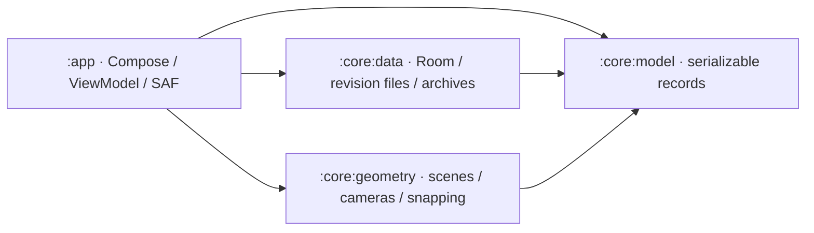
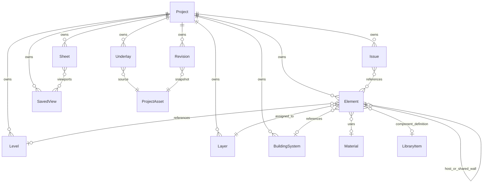

# Architecture and data model

The app implements branding/startup, project creation and a local library, portable project files, Settings, Help, and a floating-origin plan/orbit wireframe canvas from [SPEC.md](../SPEC.md). Geometry editing, coordination engines, and external CAD codecs remain separate work.

## Modules and ownership



- `:core:model` contains Android-independent document/settings records and constructor invariants. `Project.template` and additional `AppSettings` fields have backward-compatible defaults.
- `:core:data` owns the Room catalogue and settings row, document validation, immutable file revisions, assets/previews, templates, archive import/export, and repository interfaces/implementations.
- `:core:geometry` is Android-independent Kotlin/JVM code for document-to-wireframe compilation, immutable spatial batches, Double-precision plan/orbit cameras, a segment BVH, and six-mode plan snapping.
- `:app` owns Compose screens/overlays/input, the OpenGL ES 2 renderer, `AppViewModel`, lifecycle/navigation state, system file/folder pickers, permission grants, optional folder copies, and explicit feedback sharing. `EezyDrawApplication` creates one database/repository set per process.

Composables consume immutable UI state and callbacks. `AppViewModel` collects repository flows, executes suspend operations, maintains a dirty document, and exposes busy/error/notice state. It retains the route and active project ID through `SavedStateHandle`; process recreation reloads the last saved document. Unsaved edits are not claimed to survive process death.

## Startup and project flow

The original faceted E mark is supplied as [SVG](assets/eezy-draw-logo.svg), Android vectors, and adaptive/monochrome launcher icons. AndroidX SplashScreen hands off to the 1.2-second Compose logo animation and 450ms menu transition. System duration scale applies without a separate forced delay. Saved completion prevents replay on activity recreation. System-bar contrast follows splash and persisted theme.

The menu observes the real Room catalogue, ordered by last-opened time. Continue loads the first entry; recent cards load their IDs. Native preview PNGs are generated from saved room footprints (or a named blank-project card), refreshed on save, and supplied as local URIs. `ProjectThumbnail` bounds decoding to 512px on I/O and falls back to a monogram for unavailable images. Tablet widths of at least 840dp use split columns; compact layouts scroll.

Create New Project and Templates open the same validated form: name, Empty/Office/Residential/Data center, and five display-unit choices. Templates seed a level, layers, and representative room footprints. Defaults come from persisted settings. Creating, continuing, opening a recent project, or importing a file opens `AppScreen.PROJECT`, the drawing canvas. A separate `PROJECT_DETAILS` route permits name, description, and unit changes, Save, and portable Export; Back returns to the canvas. Invalid input cannot be saved. Changing display units never rescales geometry.

Busy state prevents duplicate operations. Saving commits before clearing dirty state or reporting success. Leaving a dirty project for the Start Menu saves first; a failed save keeps the draft open. Periodic autosave saves dirty documents at the configured interval; zero disables it. When autosave is enabled, activity stop also requests a save. These jobs run in the ViewModel lifetime, not a background synchronization service.

Open from file uses Android's document picker and imports a validated independent copy into the library. Export uses CreateDocument. Settings uses OpenDocumentTree with persisted read/write grants; no broad filesystem permission is requested. A selected save folder receives versioned portable copies after successful local saves. The private library remains authoritative. Folder failure reports that the local save succeeded and the external copy failed; it does not roll back or overwrite the private revision. External versioned copies are not automatically deleted.

## Settings and Help

Room persists `AppSettings` separately from documents. Settings edits a saved draft and validates before Save. Partial invalid numeric text survives rotation; leaving dirty settings requires discard confirmation. A returned folder URI is merged without erasing other draft inputs. Grid/tolerance/service-height input follows selected display units and converts back to canonical metres, including unit changes within the form.

The screen includes save location/permissions, units, angle format, precision, all six snap modes, grid size/tolerance, theme, language, autosave, backup, line weights, seven service-height defaults/reference frames, stylus/touch mode, gesture sensitivity, quality, undo history, template/export defaults, and filename patterns. Project defaults affect newly created projects; existing documents retain their settings. The canvas uses each project's units, precision, grid and snaps, plus app-level input mode, gesture sensitivity and theme. Its units/snap controls update the current document through `AppViewModel` and participate in dirty state, explicit saves and autosave. Storage/autosave/backup behavior is active. Editing line weights, service placement, undo, quality presets and drawing-export preferences await their respective engines. English and native `.eezydraw` export are the supported language/format; unavailable translations/codecs are not advertised as functioning options. Native archives remain lossless and include referenced attachments regardless of future drawing-export visibility preferences.

Help contains a current user guide, project-library and canvas gestures, keyboard accessibility, version/about/privacy, and feedback. The canvas reference describes available navigation and snap probes; selection/editing tools remain future work. Feedback opens an Android share chooser only after explicit submission. It has no invented recipient and attaches no project files; nothing is sent automatically.

## Canvas, cameras, and snapping

`DrawingCanvasScreen` compiles `ProjectDocument` into a `DrawingScene` and builds its `SpatialIndex` on `Dispatchers.Default`. The effect is keyed by project identity, elements, layers, systems and library definitions. Camera gestures, pointer probes and units/snap changes reuse the current geometry/index instead of recompiling it. Loading, invalid/oversized-scene and renderer-startup failures have visible UI states. Neither scene compilation nor the GL renderer reads Room or performs project file I/O.

`buildDrawingScene` applies local scale, intrinsic XYZ rotation (`Rx × Ry × Rz`), then project translation. It covers every current `ElementBody` and `Shape` variant as wireframe: wall reference faces and thickness, room/slab extrusions with polygon holes, library geometry scaled to component dimensions (or a size box if absent), route centrelines, and 2D/3D shapes. Hidden layers/systems are omitted and system colour overrides layer colour. Curves use up to 64 segments per turn; splines use a clamped uniform B-spline with at most degree 32. Text/leader/dimension previews use a compact stroke alphabet with a diamond for unsupported glyphs. Hatches display their boundaries and routes display their midlines; filled materials, font shaping, service cross-sections and editing tools are outside this viewer.

The scene retains Double project-space segments for snapping and bounds. Render edges are split into spatial chunks by XYZ tile and level, with a 128m maximum subdivision span per axis and at most 512 edges per chunk. Each chunk stores an origin, Double bounds and packed `xyzrgba` Float vertices relative to that origin. A scene rejects more than 500,000 semantic or subdivided render edges, 16,384 chunks, or an individual edge axis span over 64,000,000m. Limits reject a scene visibly; they do not silently omit its later elements. Scene compilation is an eager in-memory snapshot, so these safety limits are not a promise that every device can display the maximum comfortably.

`DrawingSurfaceView` embeds a render-only `GLSurfaceView` beneath Compose. `DrawingGlRenderer` uploads static vertex buffers once per scene, accepts the newest immutable `CanvasFrame` through an atomic reference, and uses `RENDERMODE_WHEN_DIRTY`. Camera updates alter uniforms, chunk culling and a bounded reusable grid buffer; they do not re-upload document buffers. The plan view uses XY rectangle culling and flattens Z, while the orbit view uses six-plane frustum culling and depth testing. A selected level includes its own chunks and unassigned/global geometry; a null level means all levels. The grid adapts its visual spacing to zoom, while snap spacing stays at the configured physical interval.

The renderer subtracts the camera centre/target from each chunk origin in Double before converting the small relative offset to Float. This keeps local detail at large project coordinates without sending absolute survey coordinates to GPU floats. Compose rulers and coordinate probes also convert locally in Double. `Viewport2D` provides anchor-preserving zoom and fit/window operations with a bounded scale of `1e-6..1e7` pixels/metre. `OrbitCamera` provides stable Z-up orbit/pan, pole-safe top/front/side/isometric presets, extent fitting, and perspective/orthographic switching that preserves target-plane framing. The canvas is unbounded by a fixed drawing page, subject to finite Double precision, camera ranges and the scene budgets above.

Compose owns pointer gestures, rulers, crosshair/reference and window markers, toolbar, bottom coordinate/snap/units/level controls, and the view cube. One-finger touch drag pans the plan; pinch zooms about the gesture centroid. Snap probe mode and a stylus in Stylus mode track without panning; a plan tap sets the reference used by perpendicular/ortho, and hover updates coordinates. In 3D, one-finger drag orbits, two fingers pan/pinch, and the Pan toolbar toggle changes single-drag behavior. Zoom window fits a dragged rectangle in either view; extents fits the selected level's visible geometry. Cube faces follow the actual camera orientation, accept face taps, and expose labelled accessibility actions. The 3D status bar reports the camera target rather than claiming a snapped model-space pick.

`SnapEngine` implements grid, endpoint, midpoint, finite-segment intersection, perpendicular and ortho in canonical project metres. The caller uses the larger of the configured physical tolerance and a 14dp capture radius converted through the current scale. The immutable BVH visits nearby edges in nearest order, caps results at 2,048, and applies deterministic node/segment work budgets in dense overlapping scenes. Intersection work uses only the nearest 64 edges. These limits bound pointer work and may omit a candidate in extremely dense input; they do not perform a full-document scan on every move. Perpendicular projects the tap reference onto a finite edge. Ortho continuously constrains to the closest horizontal/vertical axis through that reference, and other snap candidates must respect that axis. Equal-distance ties use endpoint, intersection, midpoint, perpendicular, ortho, then grid priority. Geometry snaps operate on the tessellated wireframe in XY, not analytic curves or 3D solids.

Plan/orbit cameras, active view/level and probe reference are presentation state saved through Compose savers. The host's project-keyed `SaveableStateHolder` retains them when entering Project details and returning, and supports activity recreation. They are not yet written into document `SavedView` records. Native surface lifecycle follows the host's resume/pause; disposal releases buffers/programs, and EGL context recreation rebuilds resources from the CPU scene. Rendering errors are surfaced without changing the saved project.

## Coordinate and identity conventions

- Domain lengths use metres, angles use radians, and coordinates use finite `Double` values in a right-handed Z-up coordinate frame. Display units are preferences, not a change to stored coordinates.
- Paper dimensions and line weights are explicitly suffixed `Mm` and use paper millimetres. `ParameterValue.Number.quantity` identifies SI dimensional values.
- Shape coordinates are local to their element. `Transform3` applies scale, then rotation, then translation into project coordinates. Rotation order is documented by `Rotation3`.
- `Project.origin` records a translation offset: world position = origin + project position, in metres. No geographic CRS or map projection is assumed. The current viewer works in project coordinates and subtracts its camera-local floating origin in Double before GPU Float conversion.
- IDs are distinct inline value classes around nonblank stable strings. Generation policy is left to the application/import boundary. Records reference other records by ID, so an element cannot accidentally use a layer ID as a level ID.
- Epoch timestamps use UTC milliseconds. Binary assets are referenced by `AssetId` and relative project paths, not embedded byte arrays or device-specific absolute paths.

## Data model

`ProjectDocument` is the versioned serialization envelope. It contains one `Project` and collections of project-owned records. The initial `Project.schemaVersion` is 1. Defaults support construction; they are not an implicit migration strategy.

| Source | Records and purpose |
| --- | --- |
| `Ids.kt` | Typed project, element, level, layer, system, library, material, view, issue, revision, group, sheet, and asset identities |
| `Geometry.kt` | Points, bounds, transforms, sizes, polygon rings and sealed 2D/3D shape descriptions |
| `Project.kt` | Project metadata, levels, layers, building systems, materials, project assets, and element groups |
| `Elements.kt` | Element identity/ownership plus a typed shape, wall, room, slab, component, or route body; host attachments and shared wall-face references |
| `Library.kt` | Library definitions, typed parameter values, service sections, elevation intent, and route fitting descriptions |
| `Views.kt` | Camera and saved view state, visibility, cut planes, section boxes, and calibrated underlay metadata |
| `Coordination.kt` | Stored clash results, issues/comments/markup, revision metadata, sheets and viewports |
| `Settings.kt` | Project units, snapping and service defaults; separate device-level application preferences |
| `ProjectDocument.kt` | Aggregate for representation, import/export boundaries, and future persistence mapping |



An `Element` has a stable ID, owning project, layer, optional level/system/material references, transform, tags, and custom properties. Its sealed `ElementBody` prevents unrelated payload fields from being mixed together. `Shape` and `ParameterValue` use explicit serialized discriminator names. Rectangles and triangles are polygon data; their editing tools are separate future behaviors.

### Levels, rooms, and walls

`Level.elevation` is the finished-floor elevation in project Z. The level slab occupies `[elevation - slabThickness, elevation]`; `storeyHeight` describes the rise toward the next floor. Element transforms are in project coordinates; a level reference classifies the element and does not add a second automatic elevation offset. A future level operation must update affected transforms explicitly.

Room polygons describe finish-face boundaries. A room's `RoomWallFace` references a wall element, polygon edge, ring, and side. Adjacent rooms should reference the same wall ID on opposite sides instead of storing duplicate walls. Walls retain thickness, height, their local line, and a centerline/finish-face reference convention.

Future wall generation must convert requested finish-face or centerline lines to a canonical wall representation, merge coincident shared segments within a defined tolerance, split partial overlaps, and clean joins at intersections. That operation should update both rooms' references in one transaction. Polygon winding, face alignment, wall join validity, floor continuity, and gap prevention are not computed by these records.

### Services and hosted components

`ElementBody.Route` stores a local 3D centreline, service kind, circular or rectangular section, elevation reference, fitting metadata at path vertices, and an optional host. The path describes actual geometry; `ElevationSetting` records placement intent relative to finished floor, ceiling, or project datum. A future placement operation must resolve that intent before storing a consistent path and transform.

Components reference reusable `LibraryItem` definitions while retaining instance size and parameter overrides. `HostAttachment` references a host element and its local mounting position, surface/recess/chase/opening mode, and recess depth. These relationships do not perform fitting insertion, mounting, wall boolean cuts, or geometry generation.

### Views, assets, and coordination

Underlays reference project assets and retain source format, page, metre conversion, transform, opacity, and lock state. No decoder is included. Saved views store camera, render intent, visibility overrides, and optional section/cut geometry. The live plan/orbit controller currently keeps its camera in presentation state; saved-view creation/recall and section/cut rendering are not connected yet.

Clashes are stored results, not a detector. Issues can reference elements, a saved view, markup, and comments. Revisions reference snapshot assets and an optional parent revision. Sheets describe paper dimensions, title block fields, and scaled viewports. History storage, collaboration identity, sync conflict resolution, schedules, and BOQ calculation remain future services.

## Persistence and portable format

Room schema version 1 has `projects` (identity, metadata, recent order, active revision/checksum, preview and optional backup pointers) and `settings` (singleton typed JSON preferences). KSP exports the schema under `core/data/schemas`; future database/payload changes require explicit migration. The whole drawing is not stored in one Room row. Additional normalized element/query tables can be introduced when editing/indexed geometry queries need them.

Private layout:

```text
files/projects/<project-id>/
  revisions/<revision-uuid>.json
  previews/<preview-uuid>.png
  assets/<validated-relative-path>
databases/eezy-draw.db
```

Saves validate structure, write a new atomic JSON snapshot and preview, then publish their pointers in one Room transaction. The transaction/commit flag cannot be interrupted by coroutine cancellation; failed pre-commit writes leave the previous revision intact. Cleanup after publication is best effort. Crash-orphaned files are not treated as projects. Current/backup revisions have SHA-256 checksums. Load checks schema, ownership/references, paths, and assets before updating recents. Backups retain the preceding valid document revision when enabled; corruption never silently restores older data. The error UI offers explicit recovery, and a corrupt primary is never promoted over a valid backup. Disabling backups removes the retained backup pointer on the next save.

Portable `.eezydraw` v1 is a ZIP with `document.json` containing `{format: "eezydraw", version: 1, document: ...}` and matching `assets/<relative-path>` entries. Both compressed and expanded archives are limited to 32MiB, documents to 8MiB, individual assets to 16MiB, and archives to 256 entries. Decoding checks complete ZIP footer/CRC, strict UTF-8/schema, duplicate/unsafe paths, required attachments and checksums, duplicate IDs, ownership, references, and host/revision cycles. Import assigns a fresh project ID and remaps ownership, preserving internal references while avoiding overwriting an existing project. Imported assets without a checksum gain one. Current native files are not DWG/DXF/PDF/IFC codecs.

## Remaining boundaries and validation

The wireframe viewing/camera/snap engine does not provide geometry creation/selection/transforms, topology repair, wall joins, route placement/fittings, solid booleans, shaded/realistic modes, clash detection, or external CAD codecs. Those operations remain separate from the persisted records and current viewer. Saved-view management, section/cut tools, underlay decoding and collaboration also remain future work.

Tests exercise real Room databases/files, archive corruption and attachment round trips, backup recovery, persistence after reopening, ViewModel save/failure/autosave/restore behavior, and Compose creation/settings/help/startup flows. Geometry tests cover shape conversion, transforms, large-coordinate chunks, scene limits, camera invariants, all six snaps, and deterministic 100,000-segment spatial-query regressions, including dense overlaps. Canvas Compose tests substitute a surface so gestures and controls can be checked independently of an EGL device. All 96 tests pass, debug APK assembly succeeds, and app/data lint report no issues. Camera regressions include millimetre extents/window zoom and full-height first-entry 3D framing. See the README for the current build/test report and device QA plan.

The production GLES shaders have also been exercised in a software Mesa ES 2 context for buffer layout, colours, plan-Z flattening and 3D depth, with no GL errors. This is a shader smoke check, not Android surface/lifecycle validation or a tablet frame-rate measurement. Native rendering, rapid multitouch input, GPU memory, EGL loss/background/resume, large-drawing frame times, API 26/35 behavior and real SAF providers remain device QA. No 60fps or maximum-scene device performance claim follows from the bounded-work unit tests.
