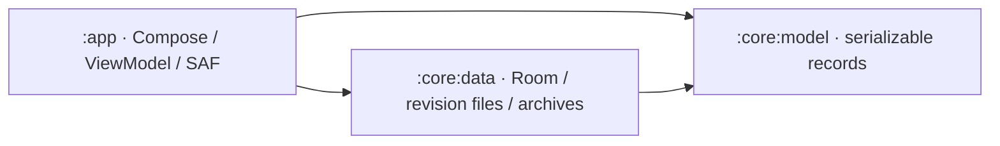
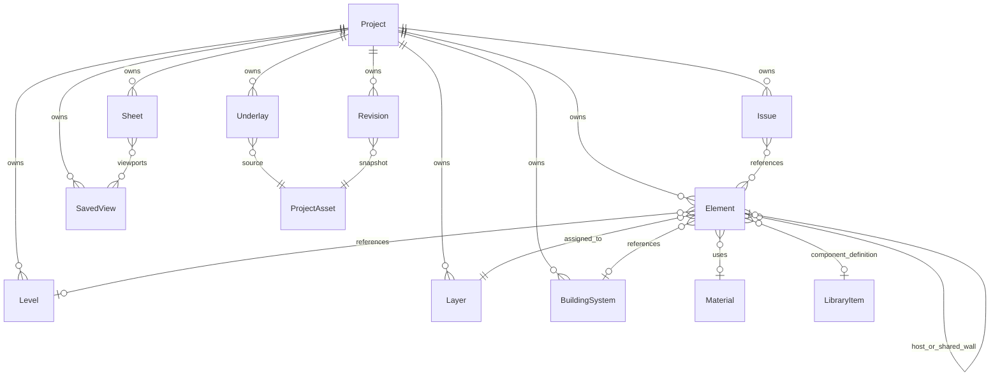

# Architecture and data model

The app implements the project foundation, branding/startup, project creation and local library, portable project files, Settings, and Help from [SPEC.md](../SPEC.md). Drawing, geometry editing, coordination engines, and external CAD codecs remain separate work.

## Modules and ownership



- `:core:model` contains Android-independent document/settings records and constructor invariants. `Project.template` and additional `AppSettings` fields have backward-compatible defaults.
- `:core:data` owns the Room catalogue and settings row, document validation, immutable file revisions, assets/previews, templates, archive import/export, and repository interfaces/implementations.
- `:app` owns screens, `AppViewModel`, lifecycle/navigation state, system file/folder pickers, permission grants, optional folder copies, and explicit feedback sharing. `EezyDrawApplication` creates one database/repository set per process.

Composables consume immutable UI state and callbacks. `AppViewModel` collects repository flows, executes suspend operations, maintains a dirty document, and exposes busy/error/notice state. It retains the route and active project ID through `SavedStateHandle`; process recreation reloads the last saved document. Unsaved edits are not claimed to survive process death.

## Startup and project flow

The original faceted E mark is supplied as [SVG](assets/eezy-draw-logo.svg), Android vectors, and adaptive/monochrome launcher icons. AndroidX SplashScreen hands off to the 1.2-second Compose logo animation and 450ms menu transition. System duration scale applies without a separate forced delay. Saved completion prevents replay on activity recreation. System-bar contrast follows splash and persisted theme.

The menu observes the real Room catalogue, ordered by last-opened time. Continue loads the first entry; recent cards load their IDs. Native preview PNGs are generated from saved room footprints (or a named blank-project card), refreshed on save, and supplied as local URIs. `ProjectThumbnail` bounds decoding to 512px on I/O and falls back to a monogram for unavailable images. Tablet widths of at least 840dp use split columns; compact layouts scroll.

Create New Project and Templates open the same validated form: name, Empty/Office/Residential/Data center, and five display-unit choices. Templates seed a level, layers, and representative room footprints without claiming wall joins or a drawing editor. Defaults come from persisted settings. Project details loads the real document and permits name, description, and unit changes, Save, and portable Export. Invalid input cannot be saved. Changing display units never rescales geometry.

Busy state prevents duplicate operations. Saving commits before clearing dirty state or reporting success. Leaving dirty project details saves before returning; a failed save keeps the draft open. Periodic autosave saves dirty documents at the configured interval; zero disables it. When autosave is enabled, activity stop also requests a save. These jobs run in the ViewModel lifetime, not a background synchronization service.

Open from file uses Android's document picker and imports a validated independent copy into the library. Export uses CreateDocument. Settings uses OpenDocumentTree with persisted read/write grants; no broad filesystem permission is requested. A selected save folder receives versioned portable copies after successful local saves. The private library remains authoritative. Folder failure reports that the local save succeeded and the external copy failed; it does not roll back or overwrite the private revision. External versioned copies are not automatically deleted.

## Settings and Help

Room persists `AppSettings` separately from documents. Settings edits a saved draft and validates before Save. Partial invalid numeric text survives rotation; leaving dirty settings requires discard confirmation. A returned folder URI is merged without erasing other draft inputs. Grid/tolerance/service-height input follows selected display units and converts back to canonical metres, including unit changes within the form.

The screen includes save location/permissions, units, angle format, precision, all six snap modes, grid size/tolerance, theme, language, autosave, backup, line weights, seven service-height defaults/reference frames, stylus/touch mode, gesture sensitivity, quality, undo history, template/export defaults, and filename patterns. Defaults affect newly created projects; existing documents retain their settings. Theme and storage/autosave/backup behavior are active now. Input, snapping, quality, undo, and drawing-export preferences are retained for their future engines. English and native `.eezydraw` export are the supported language/format; unavailable translations/codecs are not advertised as functioning options. Native archives remain lossless and include referenced attachments regardless of future drawing-export visibility preferences.

Help contains a current user guide, project-library gestures/keyboard accessibility, a clearly marked future drawing-gesture reference, version/about/privacy, and feedback. Feedback opens an Android share chooser only after explicit submission. It has no invented recipient and attaches no project files; nothing is sent automatically.

## Coordinate and identity conventions

- Domain lengths use metres, angles use radians, and coordinates use finite `Double` values in a right-handed Z-up coordinate frame. Display units are preferences, not a change to stored coordinates.
- Paper dimensions and line weights are explicitly suffixed `Mm` and use paper millimetres. `ParameterValue.Number.quantity` identifies SI dimensional values.
- Shape coordinates are local to their element. `Transform3` applies scale, then rotation, then translation into project coordinates. Rotation order is documented by `Rotation3`.
- `Project.origin` records a translation offset: world position = origin + project position, in metres. No geographic CRS or map projection is assumed. A renderer should subtract a camera-local floating origin in double precision before converting geometry to GPU floats. Keeping doubles in the model alone does not implement an infinite canvas.
- IDs are distinct inline value classes around nonblank stable strings. Generation policy is left to the application/import boundary. Records reference other records by ID, so an element cannot accidentally use a layer ID as a level ID.
- Epoch timestamps use UTC milliseconds. Binary assets are referenced by `AssetId` and relative project paths, not embedded byte arrays or device-specific absolute paths.

## Data model

`ProjectDocument` is the versioned serialization envelope. It contains one `Project` and collections of project-owned records. The initial `Project.schemaVersion` is 1. Defaults support construction; they are not an implicit migration strategy.

| Source | Records and purpose |
| --- | --- |
| `Ids.kt` | Typed project, element, level, layer, system, library, material, view, issue, revision, group, sheet, and asset identities |
| `Geometry.kt` | Points, bounds, transforms, sizes, polygon rings and sealed 2D/3D shape descriptions |
| `Project.kt` | Project metadata, levels, layers, building systems, materials, project assets, and element groups |
| `Elements.kt` | Element identity/ownership plus a typed shape, wall, room, slab, component, or route body; host attachments and shared wall-face references |
| `Library.kt` | Library definitions, typed parameter values, service sections, elevation intent, and route fitting descriptions |
| `Views.kt` | Camera and saved view state, visibility, cut planes, section boxes, and calibrated underlay metadata |
| `Coordination.kt` | Stored clash results, issues/comments/markup, revision metadata, sheets and viewports |
| `Settings.kt` | Project units, snapping and service defaults; separate device-level application preferences |
| `ProjectDocument.kt` | Aggregate for representation, import/export boundaries, and future persistence mapping |



An `Element` has a stable ID, owning project, layer, optional level/system/material references, transform, tags, and custom properties. Its sealed `ElementBody` prevents unrelated payload fields from being mixed together. `Shape` and `ParameterValue` use explicit serialized discriminator names. Rectangles and triangles are polygon data; their editing tools are separate future behaviors.

### Levels, rooms, and walls

`Level.elevation` is the finished-floor elevation in project Z. The level slab occupies `[elevation - slabThickness, elevation]`; `storeyHeight` describes the rise toward the next floor. Element transforms are in project coordinates; a level reference classifies the element and does not add a second automatic elevation offset. A future level operation must update affected transforms explicitly.

Room polygons describe finish-face boundaries. A room's `RoomWallFace` references a wall element, polygon edge, ring, and side. Adjacent rooms should reference the same wall ID on opposite sides instead of storing duplicate walls. Walls retain thickness, height, their local line, and a centerline/finish-face reference convention.

Future wall generation must convert requested finish-face or centerline lines to a canonical wall representation, merge coincident shared segments within a defined tolerance, split partial overlaps, and clean joins at intersections. That operation should update both rooms' references in one transaction. Polygon winding, face alignment, wall join validity, floor continuity, and gap prevention are not computed by these records.

### Services and hosted components

`ElementBody.Route` stores a local 3D centreline, service kind, circular or rectangular section, elevation reference, fitting metadata at path vertices, and an optional host. The path describes actual geometry; `ElevationSetting` records placement intent relative to finished floor, ceiling, or project datum. A future placement operation must resolve that intent before storing a consistent path and transform.

Components reference reusable `LibraryItem` definitions while retaining instance size and parameter overrides. `HostAttachment` references a host element and its local mounting position, surface/recess/chase/opening mode, and recess depth. These relationships do not perform fitting insertion, mounting, wall boolean cuts, or geometry generation.

### Views, assets, and coordination

Underlays reference project assets and retain source format, page, metre conversion, transform, opacity, and lock state. No decoder is included. Saved views store camera, render intent, visibility overrides, and optional section/cut geometry; no camera controller is included.

Clashes are stored results, not a detector. Issues can reference elements, a saved view, markup, and comments. Revisions reference snapshot assets and an optional parent revision. Sheets describe paper dimensions, title block fields, and scaled viewports. History storage, collaboration identity, sync conflict resolution, schedules, and BOQ calculation remain future services.

## Persistence and portable format

Room schema version 1 has `projects` (identity, metadata, recent order, active revision/checksum, preview and optional backup pointers) and `settings` (singleton typed JSON preferences). KSP exports the schema under `core/data/schemas`; future database/payload changes require explicit migration. The whole drawing is not stored in one Room row. Additional normalized element/query tables can be introduced when editing/indexed geometry queries need them.

Private layout:

```text
files/projects/<project-id>/
  revisions/<revision-uuid>.json
  previews/<preview-uuid>.png
  assets/<validated-relative-path>
databases/eezy-draw.db
```

Saves validate structure, write a new atomic JSON snapshot and preview, then publish their pointers in one Room transaction. The transaction/commit flag cannot be interrupted by coroutine cancellation; failed pre-commit writes leave the previous revision intact. Cleanup after publication is best effort. Crash-orphaned files are not treated as projects. Current/backup revisions have SHA-256 checksums. Load checks schema, ownership/references, paths, and assets before updating recents. Backups retain the preceding valid document revision when enabled; corruption never silently restores older data. The error UI offers explicit recovery, and a corrupt primary is never promoted over a valid backup. Disabling backups removes the retained backup pointer on the next save.

Portable `.eezydraw` v1 is a ZIP with `document.json` containing `{format: "eezydraw", version: 1, document: ...}` and matching `assets/<relative-path>` entries. Both compressed and expanded archives are limited to 32MiB, documents to 8MiB, individual assets to 16MiB, and archives to 256 entries. Decoding checks complete ZIP footer/CRC, strict UTF-8/schema, duplicate/unsafe paths, required attachments and checksums, duplicate IDs, ownership, references, and host/revision cycles. Import assigns a fresh project ID and remaps ownership, preserving internal references while avoiding overwriting an existing project. Imported assets without a checksum gain one. Current native files are not DWG/DXF/PDF/IFC codecs.

## Remaining boundaries and validation

Future geometry and rendering modules will implement robust predicates, snapping, topology, wall joins, route placement, floating-origin scene handling, and coordination. Future format adapters will implement supported external CAD imports/exports. Neither project details nor Help's reference gestures provide these engines.

Tests exercise real Room databases/files, archive corruption and attachment round trips, backup recovery, persistence after reopening, ViewModel save/failure/autosave/restore behavior, and Compose creation/settings/help/startup flows. The current verification passed all 47 tests (5 model, 9 storage, 33 app), APK assembly, and app/data lint with no issues. Unit/Compose tests use Robolectric rather than a physical device. Real SAF providers, permission revocation, launcher/runtime behavior on API 26/35, and process/lifecycle behavior on devices remain explicit manual QA items in the README.
