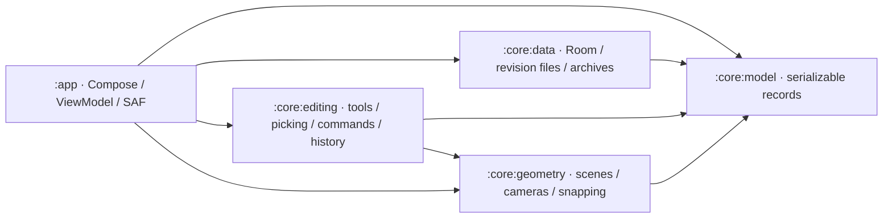
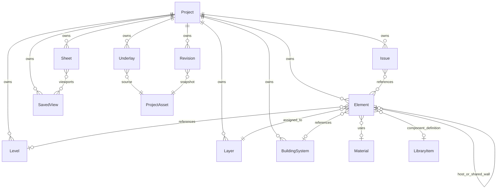

# Architecture and data model

The app implements branding/startup, project creation and a local project catalogue, a built-in Electrical/ICT component library, portable project files, Settings, Help, and a floating-origin plan/orbit editor from [SPEC.md](../SPEC.md). Drawing tools with shared precision pointing, snapped movement, local transforms, six display modes, per-object/room-wall display, persistent movable panels, lock modes and level/layer/system visibility, saved measurements, current-view PNG/PDF export, Properties and session undo/redo are implemented. Coordination engines and external CAD codecs remain separate work.

## Modules and ownership



- `:core:model` contains Android-independent document/settings records and constructor invariants, including measurement references, summaries, shared display formatting, stable component definitions and the built-in vector catalogue. Additional project/device settings, optional dimension metadata and library metadata/preferences have backward-compatible defaults.
- `:core:data` owns the Room catalogue and settings row, document validation, immutable file revisions, assets/previews, templates, archive import/export, and repository interfaces/implementations.
- `:core:editing` is Android-independent Kotlin/JVM code for validated shape/measurement factories, local physical Properties, constrained library placement and instance/bulk edits, plan/orbit picking, snapped move gestures, transform composition and sparse reversible drawing commands/history. It depends on model and geometry, with no Room, file or Compose access.
- `:core:geometry` is Android-independent Kotlin/JVM code for wireframe and triangle-surface compilation, immutable spatial batches, Double-precision plan/orbit cameras, a segment BVH, and snapping.
- `:app` owns Compose screens/overlays/input, the OpenGL ES 2 renderer, depth-tested software view export, `AppViewModel`, lifecycle/navigation state, system file/folder pickers, permission grants, optional folder copies, and explicit feedback sharing. `EezyDrawApplication` creates one database/repository set per process.

Composables consume immutable UI state and callbacks. `AppViewModel` collects repository flows, executes suspend operations, maintains a dirty document, and exposes busy/autosaving/error/notice state. It retains the route and active project ID through `SavedStateHandle`; process recreation reloads the last saved document. Unsaved edits are not claimed to survive process death.

## Startup and project flow

The original faceted E mark is supplied as [SVG](assets/eezy-draw-logo.svg), Android vectors, and adaptive/monochrome launcher icons. AndroidX SplashScreen hands off to the 1.2-second Compose logo animation and 450ms menu transition. System duration scale applies without a separate forced delay. Saved completion prevents replay on activity recreation. System-bar contrast follows splash and persisted theme.

The menu observes the real Room catalogue, ordered by last-opened time. Continue loads the first entry; recent cards load their IDs. Native preview PNGs are generated from saved room footprints (or a named blank-project card), refreshed on save, and supplied as local URIs. `ProjectThumbnail` bounds decoding to 512px on I/O and falls back to a monogram for unavailable images. Tablet widths of at least 840dp use split columns; compact layouts scroll.

Create New Project and Templates open the same validated form: name, Empty/Office/Residential/Data center, and five display-unit choices. Templates seed a level, layers, and representative room footprints. Defaults come from persisted settings. Creating, continuing, opening a recent project, or importing a file opens `AppScreen.PROJECT`, the drawing canvas. A separate `PROJECT_DETAILS` route permits name, description, and unit changes, Save, and portable Export; Back returns to the canvas. Invalid input cannot be saved. Changing display units never rescales geometry.

Busy state prevents duplicate explicit operations. Saving commits before clearing dirty state or reporting success. Leaving a dirty project for the Start Menu saves first; a failed save keeps the draft open. Periodic autosave saves dirty documents at the configured interval; zero disables it. When autosave is enabled, activity stop also requests a save. Autosave uses its own `autosaving` state and leaves `busy` false, so it does not show the modal working overlay or block drawing. Successful autosaves have no notice by default; `AppSettings.showAutosaveNotification`, exposed as Show autosave notification, defaults to false and optionally restores the success message. Explicit Save still reports success. Local save and external-copy failures remain visible. These jobs run in the ViewModel lifetime, not a background synchronization service.

A ViewModel storage mutex serializes autosave with explicit save/open/export operations. Each save writes an immutable document snapshot. Completion updates the saved baseline and repository timestamp without replacing newer drawing edits; a newer draft remains dirty and its history stays available. An operation requested while autosave is writing waits for that storage lock, rather than starting a competing publication or discarding the request. The optional autosave setting has a backward-compatible default in serialized app preferences and does not change the document/archive schema.

Open from file uses Android's document picker and imports a validated independent copy into the library. Export uses CreateDocument. Settings uses OpenDocumentTree with persisted read/write grants; no broad filesystem permission is requested. A selected save folder receives versioned portable copies after successful local saves. The private library remains authoritative. Folder failure reports that the local save succeeded and the external copy failed; it does not roll back or overwrite the private revision. External versioned copies are not automatically deleted.

## Settings and Help

Room persists `AppSettings` separately from documents. Settings edits a saved draft and validates before Save. Partial invalid numeric text survives rotation; leaving dirty settings requires discard confirmation. A returned folder URI is merged without erasing other draft inputs. Grid/tolerance/service-height input follows selected display units and converts back to canonical metres, including unit changes within the form.

The screen includes save location/permissions, units, angle format, precision, all six snap modes, grid size/tolerance, theme, language, autosave and its success-notification preference, backup, line weights, seven service-height defaults/reference frames, stylus/touch mode, gesture sensitivity, quality, undo history, template/export defaults, filename patterns, and the default-off Auto-hide panels while drawing and Lock walls by default after generating them preferences. `bodyDragMovesSelection`, `showDetailedMeasurement` and `keepToolActiveAfterPlacing` are device preferences defaulting to false. The first permits selected-body dragging; handles remain available either way. The second reveals measurement angles/coordinates, and the third enables repeated drawing-tool placement after a successful commit. Library placement always returns to Select. Project defaults affect newly created projects; existing documents retain their settings. The canvas uses each project's units, precision, grid, snaps, rotation snap, view mode and measurement visibility, plus app-level input mode, precision-pointer preferences, gesture sensitivity, detail preference and theme. Canvas settings and layer/system visibility are undoable document edits through `AppViewModel`, participate in dirty state and persist through save/autosave. Undo-history size bounds active session history. Line-weight editing, route service-height defaults and quality presets await their respective engines; library mounting uses each definition's own defaults. English, native `.eezydraw` archives and current-view PNG/PDF are supported; unavailable translations/CAD codecs are not advertised as functioning options. Native archives remain lossless and include referenced attachments regardless of future drawing-export visibility preferences.

`AppSettings.precisionPointer` stores `PrecisionPointerSettings` with backward-compatible defaults: enabled, an 80dp above-left offset, a magnifier at 3×, a nudge step that follows the active project grid, and snap haptics enabled. The offset can be 24–240dp, handedness chooses above-left/right, magnifier zoom is 2×–4×, and a custom finite positive nudge step is stored in metres. Settings drafts preserve partial numeric input and convert custom lengths only at the display-unit boundary. Turning precision off selects the previous direct-tap behavior. These are device preferences; they do not rescale geometry or require a Room schema/archive-format change.

Help contains a current user guide, project-library and canvas gestures, keyboard accessibility, version/about/privacy, and feedback. Feedback opens an Android share chooser only after explicit submission. It has no invented recipient and attaches no project files; nothing is sent automatically.

## Canvas, cameras, and snapping

`DrawingCanvasScreen` compiles `ProjectDocument` into a `DrawingScene` and, when needed for filled modes or surface measurement picks, a `SurfaceScene` on `Dispatchers.Default`. Geometry keys include project identity, elements, layers, systems, materials, levels, library definitions, measurement visibility, the device measurement-detail preference and the unit/angle/precision settings baked into labels. Full-document context remains available when compiling a selected subset, so associative measurements can resolve hosts outside that subset. Camera gestures, pointer probes and snap-setting changes reuse the geometry/index. Loading, invalid/oversized-scene and renderer-startup failures have visible UI states. Neither scene compilation nor the GL renderer reads Room or performs project file I/O.

`buildDrawingScene` applies signed local scale, intrinsic XYZ rotation (`Rx × Ry × Rz`), then project translation. It covers every current `ElementBody` and `Shape` variant as wireframe: wall reference faces and thickness, room/slab extrusions with polygon holes, library geometry scaled to component dimensions (or a size box if absent), route centrelines, and 2D/3D shapes. Its `planSymbols` option adds the definition's vector symbol at the upward-facing component surface in plan snapshots while retaining physical edges and bounds. Orbit snapshots use the physical 3D definition. Symbol coordinates scale with width/depth and follow the same signed transform as the solid; plan view export uses the same symbols. `ScenePresentation` resolves object and room-side overrides together with level/layer/system visibility. Hidden geometry is omitted by default; Show hidden objects includes faint line geometry for selection/snapping, with no hidden surfaces. Colour precedence is an explicit per-object override, system, assigned material (including a library definition's material), then layer. Curves use up to 64 segments per turn; splines use a clamped uniform B-spline with at most degree 32. Text/leader/dimension previews use a compact stroke alphabet with a diamond for unsupported glyphs. The wireframe pass retains hatch boundaries and route centrelines; closed faces and route cross-sections are supplied by the separate surface scene. Font shaping remains outside the stroke renderer.

The scene retains Double project-space segments for snapping and bounds. Render edges are split into spatial chunks by XYZ tile and level, with a 128m maximum subdivision span per axis and at most 512 edges per chunk. Each chunk stores an origin, Double bounds and packed `xyzrgba` Float vertices relative to that origin. Display and room-side metadata split override batches without splitting ordinary non-room drawing batches unnecessarily. A scene rejects more than 500,000 semantic or subdivided render edges, 16,384 chunks, or an individual edge axis span over 64,000,000m. Limits reject a scene visibly; they do not silently omit its later elements. Scene compilation is an eager in-memory snapshot, so these safety limits are not a promise that every device can display the maximum comfortably.

`DrawingSurfaceView` embeds a render-only `GLSurfaceView` beneath Compose. `DrawingGlRenderer` uploads separate immutable nonselected/selected vertex buffers, accepts the newest immutable `CanvasFrame` through an atomic reference, and uses `RENDERMODE_WHEN_DIRTY`. Camera updates alter uniforms, chunk culling and a bounded reusable grid buffer; they do not re-upload document buffers. Selection changes prepare the two scene batches off the UI thread. Handle drags transform only the selected batch through the full oriented linear model uniform and a Double-calculated per-chunk offset; they do not rebuild geometry/indexes or upload a document-sized buffer per pointer event. Nonuniform local dimension ratios are rotated into the object's XYZ orientation for preview. All offset calculations and eight-corner culling use that same full linear transform in Double before Float conversion, so an oblique resize cannot be mistaken for height-only or uniform scaling. Release commits one edit and prepares the replacement scene; cancel discards the preview. The plan view uses XY rectangle culling and flattens Z, while the orbit view uses six-plane frustum culling and depth testing. A selected level includes its own chunks and unassigned/global geometry; a null level means all levels. The grid adapts its visual spacing to zoom, while snap spacing stays at the configured physical interval.

The renderer subtracts the camera centre/target from each chunk origin in Double before converting the small relative offset to Float. This keeps local detail at large project coordinates without sending absolute survey coordinates to GPU floats. Compose rulers and coordinate probes also convert locally in Double. `Viewport2D` provides anchor-preserving zoom and fit/window operations with a bounded scale of `1e-6..1e7` pixels/metre. A blank plan starts at a useful 4m XY span rather than fitting a zero-size bound to a tiny physical region. First entry into 3D fits the current scene after placement, so the orbit camera is not left with an empty-scene framing. `OrbitCamera` provides stable Z-up orbit/pan, pole-safe aligned/isometric orientations and extent fitting. Its model retains perspective and orthographic projections; cube face/corner navigation and Home use orthographic views. Both views consume the same metre-valued scene. Display-unit conversion occurs only at numeric entry/readout boundaries; camera screen coordinates remain pixels. The canvas is unbounded by a fixed drawing page, subject to finite Double precision, camera ranges and the scene budgets above.

Compose owns pointer gestures, rulers, crosshair/reference and window markers, grouped toolbars, selection handles, side panels/dialogs, bottom coordinate/snap/units/level controls, and the view cube. Canvas drag pans the plan; pinch zooms about the gesture centroid. Snap probe mode and a stylus in Stylus mode track without panning; plan drawing picks use the snap reference for perpendicular/ortho, and hover updates coordinates. Active placement gestures aim the precision crosshair and ghost rather than moving the camera. In default precision mode, touch release never commits: Place confirms the pending point. Precision-off mode retains direct canvas-tap confirmation. Select-mode taps select geometry; an empty tap deselects. Body dragging retains camera navigation by default; enabling the device preference permits dragging an already-selected object through the same move command path. In 3D, canvas drag orbits and two fingers pan/pinch. Camera orbiting hides the active selection gizmo. Zoom window fits a dragged rectangle in either view; extents fits the selected level's visible geometry. The top-left view cube is the orientation control: drag it to orbit, tap one of six faces to align, or tap one of eight corners for an isometric direction. Home beside it resets to isometric orthographic and fits the scene. A long-press menu on the cube switches to Plan 2D, Perspective or Orthographic without adding camera preset buttons; accessibility actions expose the same choices. Cube navigation opens the orbit camera from plan; separate Top/Front/Side/Isometric and projection buttons are absent. Cube faces follow the actual camera orientation and expose labelled accessibility actions. The 3D status bar reports the camera target rather than claiming a snapped model-space construction point.

`SnapEngine` implements grid, endpoint, midpoint, finite-segment intersection, perpendicular and ortho in canonical project metres. The caller uses the larger of the configured physical tolerance and a 14dp capture radius converted through the current scale. The immutable BVH visits nearby edges in nearest order, caps results at 2,048, and applies deterministic node/segment work budgets in dense overlapping scenes. Intersection work uses only the nearest 64 edges. These limits bound pointer work and may omit a candidate in extremely dense input; they do not perform a full-document scan on every move. Perpendicular projects the tap reference onto a finite edge. Ortho continuously constrains to the closest horizontal/vertical axis through that reference, and other snap candidates must respect that axis. Equal-distance ties use endpoint, intersection, midpoint, perpendicular, ortho, then grid priority. Geometry snaps operate on the tessellated wireframe in XY, not analytic curves or 3D solids.

## Shared precision pointing

`PointPickContext` is prepared with the immutable document/scene off the UI thread and shared by all current drawing, dimension, Measure/reference and project-library point picks. It combines the plan snap index with an immutable world-segment tree for projected queries in top/front/side/orbit views. A `PrecisionPick` carries one canonical `Point3`, its current projected screen position, the snap kind, optional element identity and wall-edge flag. Crosshair, ghost, live distance and confirmation consume this same result; the finger position never becomes a separate placement coordinate. New room-corner, wall, route and fitting tools can use this input contract when their creation engines are implemented.

`offsetCrosshair` converts the screen-only preference from dp to pixels once, applies the requested above-left/right direction, flips each component when an edge blocks it, and clamps the target to the visible canvas. Stylus input bypasses the finger offset and uses the pen tip; precision confirmation still applies. Dragging adjusts the pending pick and lifting preserves it. A new touch can adjust that same candidate, while the large Place action confirms one point and clears the candidate for the next pick. A 56dp Place/Cancel pair and four touch-sized nudge arrows remain separate from the crosshair; Cancel discards the unfinished operation. Nudges use a canonical metre step from the project grid or device preference. They follow screen X/Y on plan and the camera right/up basis in orbit, retaining a project-space point rather than adding pixels to a world coordinate.

Point snapping respects visible geometry, selected-level/global inclusion, configured modes and a screen/physical capture tolerance. Plan picks preserve the active floor Z. Orbit picks use the construction floor fallback or actual snapped 3D endpoint, midpoint, finite-segment intersection, perpendicular or wall-edge positions; ortho constrains through the preceding confirmed reference. Candidates outside the canvas are rejected. The context bounds edge/node/intersection work and supplies nearby edges for the loupe, so pointer movement never rebuilds the document or performs a full-drawing scan. Curves remain tessellated for snapping, and dense-query budgets can omit a candidate. Existing factories retain their planar and degeneracy checks when consuming a confirmed point.

`PrecisionPointerOverlay` draws the crosshair, thin finger connector, snap marker/label and a live project-unit distance from the first confirmed point. Snap identity changes trigger short Compose haptic feedback when the preference is enabled. A 120dp circular loupe uses the current camera and configured 2×–4× zoom around the candidate, with a centre cross and the same snap marker. Corner placement chooses separation from both finger and target and changes corners as needed. Its local rendering uses prepared/bounded scene queries, grid and available surface data; it is not a recursive capture or a rebuild of the Android/GL view on each move. Loupe presentation does not mutate the drawing or appear in exports.

Unfinished confirmed points and fine nudges have local draft undo/redo. Cancelling clears the draft; completing an object discards its draft history and adds one normal sparse document command. Saving/autosave handles only committed document data. Camera motion and a lifted pending target do not turn into saved drawing elements, and device preferences remain independent of project undo.

Plan/orbit cameras, active view/level and probe reference are presentation state saved through Compose savers. The host's project-keyed `SaveableStateHolder` retains them when entering Project details and returning, and supports activity recreation. They are not yet written into document `SavedView` records. Native surface lifecycle follows the host's resume/pause; disposal releases buffers/programs, and EGL context recreation rebuilds resources from the CPU scene. Rendering errors are surfaced without changing the saved project.

## Display modes and surfaces

`ProjectSettings.viewMode` remembers Wireframe, Hidden Line, Shaded, Shaded with Edges, X-ray or Realistic for each project; older documents default to Wireframe. The existing `ViewMode.TRANSPARENT` and `SECTION` values remain readable compatibility modes, but the UI does not advertise section-cut functionality. View mode changes reuse the current geometry and request the needed surface snapshot. Layer/system toggles affect rendering, picking, snapping, measurements and exports through the same visibility records.

`buildSurfaceScene` emits real triangles for closed flat shapes, boxes, spheres, cylinders/cones, pyramids, extrusions/revolutions, walls, slabs, rooms, library geometry and known route sections. Open paths and annotations remain strokes. Polygon caps use even/odd scanline trapezoids, preserving concavities and holes independent of ring winding. Long triangles are subdivided before Float conversion. Each `SurfaceChunk` stores a Double origin/bounds, source element/level IDs and packed `xyz + normalXYZ + rgba` Float vertices. Normals use the inverse transpose of the element's signed XYZ transform, and reflected winding is corrected. Filled snapshots are prepared off-thread on demand; wireframe remains available without allocating surface faces. Surface work is bounded by 500,000 triangles, 16,384 chunks and an 8,000,000 polygon edge/strip work budget; rejecting a filled snapshot does not establish a device performance guarantee for smaller drawings.

The GLES surface pass and line pass have separate immutable main/selection caches. Wireframe draws edges. Hidden Line writes surface depth before testing edges. Shaded draws lit faces and remaining open/annotation strokes; Shaded with Edges adds outlines. Realistic adds a fill light and a simple specular response to ambient/key lighting; it is basic lighting, without textures, shadows or a physically based material model. In filled plan views, Z contributes top-down depth while XY retains exactly the same metres-to-pixels scale. Selected outlines and saved dimension strokes remain readable above fills. Both light and dark themes retain layer/material/system colours with contrast adjustment.

X-ray blends translucent faces and exposes rear geometry without writing depth, then draws edges. Batches are sorted for ordinary transparency; intersecting faces and separate main/selection batches are not order-independent transparency. Preview surfaces transform positions and normals with the full model/inverse-transpose matrices, using the same Double chunk offsets and culling as the line preview.

## Measurements and view sharing

Measure takes two project points and saves a dimension. Its default annotation and panel readout contain distance only, without angles or X/Y/Z. `AppSettings.showDetailedMeasurement`, exposed as Show detailed measurement (angle and coordinates), is off by default. When enabled, the same stored anchors supply horizontal distance, azimuth/elevation angles, endpoint coordinates and requested AFFL values. `measurementText` centralizes formatting; the screen applies this preference to a render-only settings copy, so changing a device preference does not dirty the project. Scene, Measurements panel and view-export snapshots use that same effective setting. `MeasurementData.showCoordinates` also defaults to false, while older serialized metadata remains readable. Dimension from reference first chooses an object, then another object or a visible grid reference, followed by a label position. Components use their insertion/mounting position; other object references use the nearest displayed corner. In orbit views, picks use visible scene edges/surfaces or the construction floor plane rather than treating screen pixels as world lengths.

Saved measurements reuse `Shape.Dimension` with optional `MeasurementData`, preserving older plain dimensions. Each `MeasurementAnchor` is local to its referenced element, local to an unassociated two-point annotation, or project-fixed for a free grid/reference endpoint. It retains a project-space fallback. Moving a reference label therefore leaves its grid endpoint fixed. Host movement therefore updates measured values when the scene is rebuilt. Summaries and labels share the same metre/radian values and project units/precision in the model, scene, panel and export. AFFL is the source point's Z minus its explicit/source level elevation, falling back to the nearest floor below it and then project datum zero. It describes the actual placed point; no unimplemented wall-placement engine is inferred from a host attachment's intent metadata.

The Measurements panel lists values and permits editing the name, two points, label point and coordinate/AFFL options, or deletion. Operations use normal sparse drawing commands and undo/redo. `ProjectSettings.showMeasurements` hides/shows these annotations without deleting them and persists through save/reopen. Copy/array remaps links when referenced objects are cloned together. Deleting a host freezes its measurement anchor at the current project position and preserves any surviving link, so the annotation stays readable and undo restores the relationship. Repository validation checks measurement element/floor references.

PNG/PDF use `ViewExportRequest`, an immutable snapshot of the committed document, current plan/orbit camera, canvas dimensions, view mode, theme, grid and level filter. Android CreateDocument selects the destination; the ViewModel writes on `Dispatchers.IO` and reports failures. The exporter reprojects geometry into a bounded software colour/depth buffer, with near/frustum clipping, filled/hidden/transparent passes and dimension strokes overlaid for readability. It exports the drawing rather than editor handles, selection tint, panels or an unfinished gesture. PNG has at most 2,048 pixels on either side; PDF embeds that same raster as a Flate-compressed RGB image in a portable PDF 1.4 page, fitted to portrait/landscape A4 with margins. It does not depend on Android native PDF state and is not editable vector geometry. Visibility and current measurement settings apply to both outputs. This is image/document sharing, not a DWG/DXF/IFC export codec.

## Canvas controls and panels

The existing Draw, Edit, View, Measure and Library launchers remain available during selection and placement. Independent `PersistentPanel` wrappers host their contents, Properties, saved Measurements and Visibility. Each panel has open, collapsed or hidden state plus an `(x,y)` top-left anchor normalized to the viewport. Content height adapts below that anchor, so selection changes do not move the panel. Its handle expands/collapses; dragging commits a clamped position at drag end rather than publishing every pointer frame. The compact View panel combines its handle and actions in one row. Panels consume their own blank-area gestures; passive canvas overlays do not intercept panel controls.

`ProjectSettings.canvasLayout` stores the panel map and full-screen `hideAll` flag. Only explicit panel callbacks change these values. Selecting/deselecting, moving, rotating, choosing a measurement, confirming a placement or applying Properties does not close or reopen another panel. The default-off `AppSettings.autoHidePanelsWhileDrawing` applies an optional temporary visibility filter to other panels during drawing/selection without changing their layout. Library is excluded from that filter: only its explicit panel controls or the full-screen toggle change its visibility. A single always-visible floating toggle hides/restores panels and retains the status bar; restoring reveals the prior saved states and positions. Properties opens on request, remains present when selection changes or becomes empty, and retains object-specific unapplied drafts through collapse. The Library panel merges built-ins with definitions carried by the project, with a project definition taking precedence for a matching ID. Choosing an insertion tool, completing/cancelling placement, selecting, editing or navigating never hides, reopens or expands Library.

`AppViewModel.setCanvasLayout` updates the document and `AppSettings.canvasLayouts` recovery map, then debounces a preference write by 150ms. This lets app/project reopening recover the latest layout even with ordinary document autosave disabled. Portable project saves also contain the layout. Layout is outside document history: command settings comparisons/application preserve the current `canvasLayout`, so undoing an older edit cannot rewind a later panel arrangement. Docking remains separate work.

The five-action selection toolbar remains Move/Rotate, Copy, Delete, Properties and More. More contains transform/clipboard/history commands, Lock/Unlock and lock policy/level actions, Display overrides, room-wall selection/actions, Visibility and panel controls. `ObjectVisibilityPanel` is a small scrollable panel for levels, rooms and outer/hole wall sides, standalone walls, other objects, layers and systems. Eye controls change saved visibility; Show all clears hiding while retaining intentional X-ray/wireframe styles. Show hidden objects as faint outlines enables deliberate recovery and interaction with hidden geometry. No extra main-screen display/lock buttons are introduced.

## Object locks and display state

`ElementState.kt` stores optional presentation values in the existing custom-property map. `LockMode` is NONE, POSITION_ONLY or ALL; the earlier `eezydraw.locked=true` flag still reads as ALL. ALL rejects geometric/numeric edits, colour/layer edits and deletion. POSITION_ONLY protects stored insertion X/Y/Z: numeric rotation/size and deletion remain allowed, while move operations are rejected. For one position-locked object, rotation and uniform scaling pivot at that insertion; edge/corner size handles that would move it are unavailable. Numeric local dimensions remain editable. Locked objects remain selectable, measurable and snappable, show a padlock when selected, and retain readonly Properties; the message explains that unlocking is required for blocked fields. Layer locks are a separate restriction.

`PresentationCommands` prepares sparse lock, display, level visibility and room-side changes. A narrow trusted presentation path permits changing these values through locked objects without allowing body/transform edits. Level lock commands affect the current level, with null denoting the all-level view. `lockGeneratedWalls` applies the generation preference only to newly added unlocked `ElementBody.Wall` records; opening/importing existing records does not silently relock them. These commands use the ordinary document dirty/save/autosave/history path and short notices with Undo.

`ObjectDisplay` is NORMAL, HIDDEN, XRAY or WIREFRAME. `RoomSideRef` identifies a room plus an outer or hole ring edge; side values are independent of the room body and explicit NORMAL can override an inherited room style. Virtual room walls have separate tagged batches, while a linked physical wall suppresses its duplicate virtual face and resolves related room-side overrides. A shared physical wall has one effective display result, rather than separate independent finish-face objects. A wholly hidden room does not by itself hide a wall still owned by another visible room, while an explicit hidden side of a visible owner hides that shared wall. Show all walls of a room restores its sides and physical wall records, and normalizes related references from other rooms in the same undoable transaction so a stale shared-side override cannot keep the wall hidden. Room floor/ceiling caps retain the whole-room mode. `unfilteredGeometryDocument` is used for physical bounds and reference points so hiding or styling a wall never shrinks numeric dimensions or changes measurement anchors.

Scene line/surface chunks carry object display, optional room side and room-centre metadata. NORMAL inherits project mode; WIREFRAME draws edges without face/depth occlusion; XRAY uses a translucent face/edge pass even when project mode is wireframe; HIDDEN is absent unless faint outlines are enabled. Geometry construction and the picker use the same visibility rules. `RoomWallIndex` aggregates complete side bounds once and classifies near-side walls using the current camera and room centre. Auto X-ray front walls only changes per-frame pass choice in 3D and does not rebuild/upload geometry or rewrite stored manual overrides. Top/steep views may still see opaque room caps; the feature is a front-wall aid, not a section or ceiling-removal engine. Native rendering and PNG/PDF export share the display policies.

## Drawing tools, selection, and editing

`DrawingTool` declares minimum point counts and automatic completion for point-driven construction. `createSketch` accepts canonical project points and `ToolOptions`, returning a `SketchGeometry` with local `Shape` data and a `Transform3`. `supportsDefaultPlacement` identifies the ten closed/solid tools; `createDefaultSketch` inserts one of them at a single snapped anchor using physical option dimensions. `ToolOptions` stores width/depth/height in metres, all initially 1m. Width is the diameter for circle/sphere/cylinder/cone; sphere ignores independent depth/height options so a default sphere has a 0.5m radius and stays round. Ellipse uses width/depth diameters. Rectangle, box, pyramid, isosceles triangle and normalized six-sided polygon use exact width/depth footprints. Solid height applies to box/cylinder/cone/pyramid. Two-dimensional shapes remain flat. The UI displays and parses those options in the project's mm/cm/m/in/ft units, with one conversion at the boundary, and Draw by points switches to the original picked-point construction without overriding its measurements.

The application assigns element/project/layer/level IDs and commits a complete object through the command path. Tool factories validate their required plane and degeneracy constraints; local coordinates are normalized around an insertion point or curve centre before any GPU Float conversion. Default factories construct local physical dimensions before adding the placement anchor, so zoom, pixel distances and survey coordinates cannot determine a default object's proportions. Lengths below `1e-9`m, nonfinite/degenerate geometry, duplicate path edges and collinear arc/angular picks are rejected without partially changing a document. Layer association does not implicitly add elevation. The selected level supplies the default floor, while a precision snap can retain an actual 3D elevation in its confirmed canonical point.

| Tool | Construction (Draw by points for sized tools) |
| --- | --- |
| Line | Start/end; completes after two picks |
| Polyline | Two or more vertices, optional closed outline; explicit Done |
| Arc | Start/middle/end; circumcircle sweep passes through the middle, including clockwise/major arcs |
| Circle / sphere | Centre and radius point |
| Ellipse | Centre and corner defining the two XY radii |
| Rectangle / box | Opposite base corners; box normalizes reversed picks and uses numeric height |
| Polygon / triangle | Picked outline; polygon uses explicit Done, triangle completes at three vertices |
| Spline | Three or more control points, degree `min(3, count − 1)`; explicit Done |
| Text | Insertion point and numeric text height/content |
| Leader | Two or more path points, starting at the arrow tip with text at the final point; explicit Done |
| Aligned / radial dimensions | Two measurement anchors, then label placement |
| Angular dimension | Vertex, two arm points, then label placement |
| Cylinder / cone | Centre/radius and numeric height |
| Pyramid | Opposite rectangular base corners; centred apex at numeric height |

Sized tools need a single confirmed placement point by default; the table describes their optional Draw by points sequences and the freeform/annotation tools. Choosing any drawing, measurement or project-library tool updates presentation state only: it highlights the active tool, displays a hint plus Cancel/Done, and prepares a translucent ghost. `ConstructionPreview` compiles disposable sketch scenes without editing the document, including a fallback before the first point; measurement previews retain only temporary points. Cursor updates move the ghost. In default precision mode, a canvas touch only aims and Place adds the confirmed point or commits an object through the normal command path; disabling precision restores direct-tap confirmation. Done completes a valid multi-point construction or leaves the tool; Cancel discards unfinished points. Completion briefly shows Placed and selects the new object. By default it resets to Select; `keepToolActiveAfterPlacing` preserves drawing tools for repeated use. Library placement always returns to Select, including when that preference is enabled. Each completed placement is one undo step. Rectangle/triangle/polygon tools produce `Shape.Polygon`. Creation uses the selected level floor or a confirmed precision elevation, with tool-specific planar rules and numeric positive solid height; orbit views and transforms expose the resulting geometry. A sphere extends above and below its centre. The app does not infer arbitrary front/side construction planes. Numeric placement dimensions and editable text/height remain in the collapsible panel; automatic panel docking is not implemented.

`EditorPicker` reuses the scene's segment BVH for nearby plan outlines and builds a second immutable element-bounds tree to prune closed-interior and orbit candidates. Bounds are a broad phase, not a hit. Closed circles/ellipses/polygons and supported solids use local-space analytic/ray tests after inverse element transforms; empty holes are respected. Open curves, text, leaders, dimensions and detailed library geometry remain selectable by their displayed outlines. Orbit outline candidates use projected distance/depth; closed-interior hits use ray depth. Hidden geometry is absent, and selected-level rules include unassigned/global objects.

The selected bounding volume locates a 52dp centre square with a four-arrow move icon and fixed-screen-size red X, green Y and blue Z arrows. Move is the default mode. The square moves freely on ground XY while preserving pivot Z in both plan and orbit views; arrows constrain motion to one project axis, including raising/lowering along Z. Every move handle has at least a 48dp target. `moveAxisScreenDirection` gives projected directions and explicit screen-space fallbacks when an axis points into the camera, so all three remain usable in plan/top/front/side/orbit views. `MoveContext` prepares a nearby snap index once per selection, excluding selected geometry and annotations following that selection. Grid, endpoint, midpoint, intersection, perpendicular and ortho use bounded candidates/tolerance and respect the active move constraint. Axis candidates retain the two untouched coordinates; the physical grid also supplies Z positions. Ground movement uses the horizontal plane, with a stable screen-space depth mapping when that plane is edge-on. A drag previews one immutable delta and releases as one undoable edit; a second pointer cancels it. When enabled, body dragging invokes this same move context.

A single selected object's `ResizeFrame` derives physical local bounds from its original geometry, signed scale and full intrinsic XYZ rotation. Width/depth side handles change only their matching dimension and hold the opposite side fixed. Four base corners change width/depth and hold the opposite corner fixed; Keep width/depth proportions requests a shared XY ratio without changing height. A separate top handle changes only height and holds the physical base fixed. Mirror signs are preserved, and rotating an object does not turn its local width into world height. Multiple-selection scaling remains uniform. Rotation and resize controls have shapes/colours separate from the grab handle.

A handle must receive the initial down event before a transform begins; body drags retain camera navigation behavior unless the device preference permits movement. Move axes parallel to the view use the documented fallback rather than disappearing. In explicit Scale mode, edge-on base planes may hide corner controls that cannot determine two independent local dimensions. `screenAxisDrag` uses camera rays for stable physical axis displacements in perspective and at large coordinates. Resize calculations return an oriented nonuniform `EditDelta` that previews and commits the same physical ratios. Numeric Properties applies one object atomically: project X/Y/Z translation, intrinsic Rotation X/Y/Z (stored radians, shown in degrees) and the same physical local-axis width/depth/height used by the handles (stored metres, shown in project units). Sizes include absolute existing scale before rotation, preserve mirror signs on resize and cannot turn a flat axis into thickness. Untouched rounded fields retain their original canonical values.

Rotate mode replaces move arrows with red X, green Y and blue Z rotation bands. `RotationGesture` intersects a camera ray with the plane perpendicular to the chosen project axis, falling back to a visible screen dial for edge-on rings. `ProjectSettings.rotationSnapDegrees` defaults to 15 and permits 1, 5, 15, 45 or 90; the current snapped angle is shown during the drag. `EditDelta.rotation` represents the full XYZ rotation and retains the legacy Z-only field for existing callers. GPU preview and committed orientation compose the same project-axis rotation with the object's current intrinsic XYZ orientation. Rotate 90° in More applies a single Z quarter-turn command. A second pointer cancels a handle gesture. A committed transform keeps its GPU preview until the matching scene is ready, while rejected/no-op commands clear it. Geometry/selection readiness gates handles so an older selection batch cannot preview a newer object's edit. Construction snapping includes selected geometry, allowing consecutive shapes to join the most recently created object. While a scene is being rebuilt, grid/ortho remain available without querying stale edges. Level/view filters remove selections that would become hidden, and canvas keyboard shortcuts run only with canvas focus.

Plain drawing-tool dimensions retain fixed local anchors. Aligned/radial lengths and angular angles are recomputed from transformed world anchors when compiling labels, using the project's length unit, angle format and decimal precision. Aligned labels store a perpendicular offset, angular labels an offset from the vertex, and radial labels an offset from the circumference anchor. Saved Measure/Dimension from reference annotations additionally resolve the optional links described above. Wireframe annotations include extension/dimension lines, inward arrows and measured text; `DEG`/`RAD` and unit suffixes fit the stroke alphabet. Nonuniform scaling updates plain dimension values, while associated measurements follow referenced host points. Leaders retain the model's fixed 0.25m text preview height.

`EditCommands` prepares validated immutable changes; `EditHistory` applies them and stores sparse before/after element records and indexes, changed auxiliary layer/system/group/issue/library-definition/material lists, and an optional before/after `ProjectSettings` value. History entries never retain full `ProjectDocument` snapshots. Stale/project-mismatched commands fail before consuming history. `AppSettings.undoLimit` bounds entry count; a 250,000 changed/auxiliary-record budget additionally evicts old entries, while retaining one larger operation so the latest change remains reversible. Undo/redo covers geometry, object style/lock/layer/display, room-side display, canvas settings, level/layer/system visibility and library placement/instance/bulk/reset edits. New definitions, systems and materials introduced by a library operation share that operation's undo step; optional auxiliary patches are absent when the lists did not change. Library favorites, recent IDs and grid/list preference remain outside drawing history, so undo cannot rewind later browsing preferences. It is session-only and separate from persisted revision backups and metadata edits. Undoing a project-settings patch changes only settings, preserving independent project names/timestamps. A new edit clears redo; no-op/failed edits preserve it. Camera gestures, panel opening and clipboard copying are presentation/session operations without document-history entries. Precision-point drafts/nudges use their own transient undo/redo until the finished object enters document history. The ViewModel applies committed edits to the normal dirty/save/autosave document.

Copy/Paste uses a project-local in-app clipboard, creates new IDs and remaps references among cloned elements. Array clones the selected set in project X/Y rows/columns with a 1,000-new-object safety limit. Mirror X/Y reflects actual geometry across a project plane through the chosen pivot: `Scale3` permits finite nonzero signed axes to encode reflected handedness without duplicating/reversing shape data. Project-axis rotations compose with the model's intrinsic XYZ orientation. `ElementState.kt` reserves `eezydraw.locked` (`ParameterValue.Flag`) and `eezydraw.colour` (`ParameterValue.Colour`) in existing custom properties. Colour overrides are shared by wireframe and surface compilation. ALL object locks and layer locks reject geometric edits; POSITION_ONLY follows the insertion-preservation rules above. The More action labelled Unlock layer clears the selected layer restriction first; if an object lock remains, the next Unlock clears that object lock. Each change is independently undoable. Delete detaches affected host/shared-wall links and removes group/issue/clash references in the same undoable command; undo restores those links and original ordering. These optional properties and backward-compatible settings require no Room schema or archive-format change.

## Coordinate and identity conventions

- Domain lengths use metres, angles use radians, and coordinates use finite `Double` values in a right-handed Z-up coordinate frame. Display units are preferences, not a change to stored coordinates.
- Paper dimensions and line weights are explicitly suffixed `Mm` and use paper millimetres. `ParameterValue.Number.quantity` identifies SI dimensional values.
- Shape coordinates are local to their element. `Transform3` applies finite nonzero signed scale, then rotation, then translation into project coordinates. Negative axes encode mirror handedness. Rotation order is documented by `Rotation3`; stored angles remain radians even though Properties shows degrees.
- `Project.origin` records a translation offset: world position = origin + project position, in metres. No geographic CRS or map projection is assumed. The current viewer works in project coordinates and subtracts its camera-local floating origin in Double before GPU Float conversion.
- IDs are distinct inline value classes around nonblank stable strings. Generation policy is left to the application/import boundary. Records reference other records by ID, so an element cannot accidentally use a layer ID as a level ID.
- Epoch timestamps use UTC milliseconds. Binary assets are referenced by `AssetId` and relative project paths, not embedded byte arrays or device-specific absolute paths.

## Data model

`ProjectDocument` is the versioned serialization envelope. It contains one `Project` and collections of project-owned records. The initial `Project.schemaVersion` is 1. Defaults support construction; they are not an implicit migration strategy.

| Source | Records and purpose |
| --- | --- |
| `Ids.kt` | Typed project, element, level, layer, system, library, material, view, issue, revision, group, sheet, and asset identities |
| `Geometry.kt` | Points, bounds, transforms, sizes, polygon rings and sealed 2D/3D shape descriptions |
| `Project.kt` | Project metadata, levels, layers, building systems, materials, project assets, and element groups |
| `Elements.kt` / `ElementState.kt` | Element identity/ownership plus a typed shape, wall, room, slab, component, or route body; host attachments, shared wall-face references, and reserved per-object lock/colour/display and room-side presentation properties |
| `Library.kt` / `BuiltInLibrary.kt` | Library definitions, mounting defaults, plan symbols, typed parameters, browsing preferences/search and the built-in catalogue; service sections, elevation intent and route fitting descriptions |
| `Views.kt` | Camera and saved view state, visibility, cut planes, section boxes, and calibrated underlay metadata |
| `Coordination.kt` | Stored clash results, issues/comments/markup, revision metadata, sheets and viewports |
| `Settings.kt` | Project units, snapping and service defaults; separate device-level application preferences |
| `ProjectDocument.kt` | Aggregate for representation, import/export boundaries, and future persistence mapping |



An `Element` has a stable ID, owning project, layer, optional level/system/material references, transform, tags, and custom properties. Its sealed `ElementBody` prevents unrelated payload fields from being mixed together. `Shape` and `ParameterValue` use explicit serialized discriminator names. Rectangles and triangles use polygon data, created through their dedicated tools rather than new serialized variants.

### Levels, rooms, and walls

`Level.elevation` is the finished-floor elevation in project Z. The level slab occupies `[elevation - slabThickness, elevation]`; `storeyHeight` describes the rise toward the next floor. Element transforms are in project coordinates; a level reference classifies the element and does not add a second automatic elevation offset. A future level operation must update affected transforms explicitly.

Room polygons describe finish-face boundaries. A room's `RoomWallFace` references a wall element, polygon edge, ring, and side. Adjacent rooms should reference the same wall ID on opposite sides instead of storing duplicate walls. Walls retain thickness, height, their local line, and a centerline/finish-face reference convention.

Future wall generation must convert requested finish-face or centerline lines to a canonical wall representation, merge coincident shared segments within a defined tolerance, split partial overlaps, and clean joins at intersections. That operation should update both rooms' references in one transaction. Polygon winding, face alignment, wall join validity, floor continuity, and gap prevention are not computed by these records.

### Services and hosted components

`ElementBody.Route` stores a local 3D centreline, service kind, circular or rectangular section, elevation reference, fitting metadata at path vertices, and an optional host. The path describes actual geometry; `ElevationSetting` records placement intent relative to finished floor, ceiling, or project datum. A future placement operation must resolve that intent before storing a consistent path and transform.

Components reference reusable `LibraryItem` definitions while retaining instance size and parameter overrides. `HostAttachment` references a host element and its local mounting position, surface/recess/chase/opening mode, and recess depth. Library placement resolves surface mounting and stores the resulting transform/host; attachments do not perform wall boolean cuts, recess/chase generation or routing fitting insertion.

### Component library and placement

`BuiltInLibrary` constructs its immutable catalogue once on first use. Its 32 definitions have stable `eezy.electrical.*` / `eezy.ict.*` IDs, nominal SI dimensions, mounting defaults, material/system/colour defaults, separate vector `symbolGeometry` and physical `geometry`. A project copies only a definition it places; project-carried definitions override the corresponding built-in without modifying the global catalogue.

| Folder | Definitions |
| --- | --- |
| Electrical (19) | Single/double switch, dimmer, socket, floor box, isolator, distribution board, downlight, linear light fitting, emergency light, exit sign, junction box, pull box, cable tray, cable ladder, trunking, conduit, earth bar and earth rod |
| ICT / low current (13) | 42U/24U/12U rack, patch panel, cable basket, data outlet, fibre box, Wi-Fi access point, CCTV camera, access control reader, intercom, PA speaker and TV outlet |

`LibraryPanel` uses collapsible icon folders, case/punctuation-insensitive multiword search, Favorites, Recently used and grid/list views. Each entry shows a vector thumbnail, name and width × depth × height in project units. A `LazyColumn` composes visible rows; thumbnails draw remembered vector geometry without bitmap decoding, file I/O or a full-catalogue image cache. This bounds UI composition for hundreds of project definitions without claiming physical-tablet frame rates. Search and folder drafts survive panel collapse/reopening in the canvas session. `ProjectDocument.libraryState` persists favorite IDs, at most 24 unique recent IDs and the grid/list preference through normal project save/load/archive import. These browsing changes dirty the document but create no drawing-history entry.

`previewLibraryPlacement` is shared by ghost preview and commit. Floor items use the selected level's finished-floor elevation, or project datum when no level exists. Wall items use their definition's default AFFL mounting height (a single switch starts at 1.2m), find the nearest eligible visible finish face on that level, align local +X along it and local +Y outward, and keep the full width/height within the wall face. It handles standalone centerline/left/right-reference walls and visible implicit room boundary/hole faces, while linked physical walls suppress duplicate implicit faces. Rotated, scaled and mirrored upright hosts use their transformed finish face; tilted/too-small faces are ineligible. Missing eligible wall faces produce a placement message rather than a floating wall item. The stored attachment uses the host's local coordinates.

Ceiling items use a containing visible room's ceiling when available, otherwise `Level.storeyHeight - slabThickness` above that level's floor (3m above datum when there is no level). The insertion is on the ceiling plane and a negative local Z scale makes the physical shape hang below it. The displayed mounting height is the actual insertion AFFL in project units. Choosing a library entry activates the shared hint banner, ghost, precision crosshair/loupe/nudges and Place/Cancel flow. Previewing, aiming and lifting do not create an element. Successful placement selects the result and always returns to Select; Cancel discards the draft. Library's saved panel state remains unchanged throughout.

Properties exposes physical local width/depth/height, mounting height, material, colour, system, manufacturer, model and name tag alongside the ordinary numeric transform. `LibraryInstanceProperties` reads/writes the existing component size and stable parameter keys. Numeric dimensions update the 2D symbol, physical 3D geometry and bounds together while preserving rotation and mirrored handedness. Mounting-height edits resolve against that instance's level. Nonblank material/system names reuse case-insensitive matching project records or create actual `MaterialId`/`SystemId` associations in the same undoable transaction, so visibility and display colour rules remain consistent. Other parameters remain instance-local.

Apply affects the selected instance. Update all of this type in the project copies those parameters and local size to every instance with the same definition ID, preserving each instance's insertion X/Y and orientation and resolving mounting heights against its own floor. Lock checks reject a blocked bulk edit atomically. Reset to library default restores that instance's definition size/parameters and mounting default (or the current ceiling), preserving a position-only lock's insertion. Move, rotate, lock, hide, measurement references, copy/array, undo/redo and project save/load use the ordinary element paths. Continuous host constraints after an explicit move, wall recess/chase booleans, custom-library authoring, save-as-new and library import/export management remain outside this implementation.

### Views, assets, and coordination

Underlays reference project assets and retain source format, page, metre conversion, transform, opacity, and lock state. No decoder is included. Saved views store camera, render intent, visibility overrides, and optional section/cut geometry. The live plan/orbit controller currently keeps its camera in presentation state; saved-view creation/recall and section/cut rendering are not connected yet.

Clashes are stored results, not a detector. Issues can reference elements, a saved view, markup, and comments. Revisions reference snapshot assets and an optional parent revision. Sheets describe paper dimensions, title block fields, and scaled viewports. Persisted revision-history browsing, collaboration identity, sync conflict resolution, schedules, and BOQ calculation remain future services; session undo/redo does not use these revision records.

## Persistence and portable format

Room schema version 1 has `projects` (identity, metadata, recent order, active revision/checksum, preview and optional backup pointers) and `settings` (singleton typed JSON preferences). KSP exports the schema under `core/data/schemas`; database changes require explicit migration. Library metadata, plan symbols and `ProjectDocument.libraryState` add serialized fields with backward-compatible defaults, so this change keeps Room schema 1, project schema 1 and native archive format 1. Older definitions retain their existing geometry and default to floor placement with no added plan-symbol strokes; geometry-free definitions retain the size-box fallback. Older documents default to empty favorites/recents and grid view. The whole drawing is not stored in one Room row. Additional normalized element/query tables can be introduced when editing/indexed geometry queries need them.

Private layout:

```text
files/projects/<project-id>/
  revisions/<revision-uuid>.json
  previews/<preview-uuid>.png
  assets/<validated-relative-path>
databases/eezy-draw.db
```

Saves validate structure, write a new atomic JSON snapshot and preview, then publish their pointers in one Room transaction. The transaction/commit flag cannot be interrupted by coroutine cancellation; failed pre-commit writes leave the previous revision intact. Cleanup after publication is best effort. Crash-orphaned files are not treated as projects. Current/backup revisions have SHA-256 checksums. Load checks schema, ownership/references, paths, and assets before updating recents. Backups retain the preceding valid document revision when enabled; corruption never silently restores older data. The error UI offers explicit recovery, and a corrupt primary is never promoted over a valid backup. Disabling backups removes the retained backup pointer on the next save.

Portable `.eezydraw` v1 is a ZIP with `document.json` containing `{format: "eezydraw", version: 1, document: ...}` and matching `assets/<relative-path>` entries. Both compressed and expanded archives are limited to 32MiB, documents to 8MiB, individual assets to 16MiB, and archives to 256 entries. Decoding checks complete ZIP footer/CRC, strict UTF-8/schema, duplicate/unsafe paths, required attachments and checksums, duplicate IDs, ownership, references, and host/revision cycles. Import assigns a fresh project ID and remaps ownership, preserving internal references while avoiding overwriting an existing project. Imported assets without a checksum gain one. Current native files are not DWG/DXF/PDF/IFC codecs.

## Remaining boundaries and validation

The editor provides the requested drawing/annotation tools, primitive construction, geometry selection and transforms. Revision-cloud/hatch/extrude/revolve creation, topology repair, wall joins, route placement/fittings, solid booleans, clash detection and external CAD codecs remain future work. Saved-view management, section/cut tools, underlay decoding, automatic panel docking, custom-library authoring/import/export management and collaboration also remain outside this implementation. Plain dimensions retain fixed local anchors; saved reference measurements follow their hosts. The selected level supplies the default construction floor and tool factories retain their plane constraints. Room/wall creation and routing/fitting tools are not added by the shared precision-input infrastructure.

The suite has 510 passing tests: model 27, geometry 83, editing 168, storage 15 and app 217, a debug APK build and zero app/storage debug lint issues. Results for this library and placement update are recorded in [TEST_REPORT.md](TEST_REPORT.md). Tests exercise real Room databases/files, archive corruption and attachment round trips, backup recovery, persistence after reopening, ViewModel save/failure/autosave/restore behavior, and Compose creation/settings/help/startup flows. Geometry tests cover shape conversion, transforms, large-coordinate chunks, scene limits, camera invariants, all six snaps, and deterministic 100,000-segment spatial-query regressions, including dense overlaps. Editing regressions cover all 19 creation tools, directed arcs, invalid picks, large-coordinate local geometry, measured dimensions, analytic selection/holes, perspective axis drags, local Properties, mirror composition, reference-safe copy/delete/array, sparse history and its budgets. Precision-pointer regressions cover offset/flipping and loupe geometry, confirm-only placement, retained candidates, nudges, snapping and preference persistence/restoration. Existing regressions cover mode-exclusive gizmos, axis-isolated XYZ move/rotation and snaps, sparse settings/style history, preview-only tool activation, placement cancellation/reset, distance-only defaults and cube navigation. Existing regressions check sized defaults across all five project units, directional handle isolation and fixed pivots, rotated/mirrored shapes, Properties agreement, and silent autosave/notification settings. Canvas Compose tests substitute a surface to exercise tools, numeric Properties, handle-only movement, multitouch cancellation, selected-object snapping and save/reopen. Real persistence tests retain all shape variants and signed mirrored scales. Camera regressions include millimetre extents/window zoom and full-height first-entry 3D framing. See [TEST_REPORT.md](TEST_REPORT.md) for commands and results.

The current production line and surface GLES shaders pass [the software Mesa ES 2 check](../scripts/gles_shader_smoke.py) for buffer layout, colours, plan-Z flattening, 3D depth and selected model-uniform transforms. Translation, 90-degree rotation, scaling about a nonzero pivot, separate width/depth/height changes, rotated local resizing and combined transforms near billion-metre coordinates reuse one selected VBO, with no GL errors. A software shader smoke check does not validate Android surface/lifecycle behavior or tablet frame rates. Native rendering, rapid multitouch/handle input, GPU memory, EGL loss/background/resume, large-drawing frame times, API 26/35 behavior and real SAF providers remain device QA. Tests additionally cover surface triangulation/holes/normals, all view passes, move snapping and body-drag preferences, associative measurement values/host cleanup, saved view visibility, panel draft/full-screen flows and PNG/PDF output. No 60fps or maximum-scene device performance claim follows from the automated tests.
