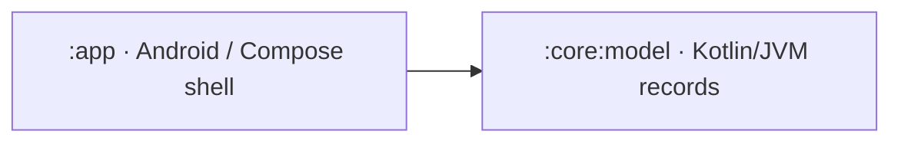
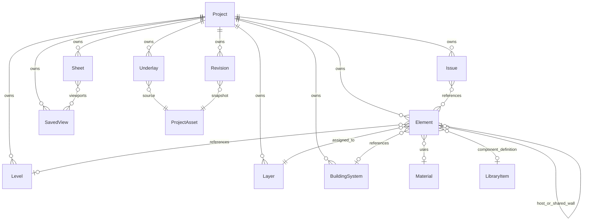

# Architecture and data model — Part A

The current scope is the Android Studio project, folder structure, and data model from [SPEC.md](../SPEC.md). All feature behavior remains for subsequent work. The app contains one Compose entry point with a static foundation screen. The model module defines immutable Kotlin records and constructor invariants without Android, rendering, storage, or UI dependencies.

## Module boundaries

`:app` owns the manifest, activity, resources, and theme. `:core:model` owns serializable value types and their immediate structural constraints. Only these two modules exist; no empty feature modules or services are registered.

As features are implemented, use the following boundaries:

| Future boundary | Responsibility |
| --- | --- |
| `core:data` | Room database, entities/DAOs, project assets, model mappers, repository implementations, migrations |
| `core:domain` | Repository interfaces, use cases, document validation, commands and undo/redo contracts |
| `core:geometry` | Double-precision predicates, snapping, topology, wall joins, routing and clash calculations |
| `core:rendering` | Canvas/scene adapter, floating origin, picking, GPU resources and render modes |
| `core:formats` | Validated import/export adapters for supported external formats |
| `feature:*` | Compose screens and ViewModels for projects, editor, library, coordination, settings, and help |

Feature ViewModels will expose immutable UI state and receive user actions. They will call domain operations and repositories; composables will not operate on Room entities or GPU objects. Renderer-specific handles, Android `Uri` objects, Room annotations, and UI state do not belong in `core:model`. Rendering backend and external CAD codec selection remain future implementation decisions.

## Coordinate and identity conventions

- Domain lengths use metres, angles use radians, and coordinates use finite `Double` values in a right-handed Z-up coordinate frame. Display units are preferences, not a change to stored coordinates.
- Paper dimensions and line weights are explicitly suffixed `Mm` and use paper millimetres. `ParameterValue.Number.quantity` identifies SI dimensional values.
- Shape coordinates are local to their element. `Transform3` applies scale, then rotation, then translation into project coordinates. Rotation order is documented by `Rotation3`.
- `Project.origin` records a translation offset: world position = origin + project position, in metres. No geographic CRS or map projection is assumed. A renderer should subtract a camera-local floating origin in double precision before converting geometry to GPU floats. Keeping doubles in the model alone does not implement an infinite canvas.
- IDs are distinct inline value classes around nonblank stable strings. Generation policy is left to the application/import boundary. Records reference other records by ID, so an element cannot accidentally use a layer ID as a level ID.
- Epoch timestamps use UTC milliseconds. Binary assets are referenced by `AssetId` and relative project paths, not embedded byte arrays or device-specific absolute paths.

## Data model

`ProjectDocument` is the versioned serialization envelope. It contains one `Project` and collections of project-owned records. The initial `Project.schemaVersion` is 1. Defaults support construction; they are not an implicit migration strategy.

| Source | Records and purpose |
| --- | --- |
| `Ids.kt` | Typed project, element, level, layer, system, library, material, view, issue, revision, group, sheet, and asset identities |
| `Geometry.kt` | Points, bounds, transforms, sizes, polygon rings and sealed 2D/3D shape descriptions |
| `Project.kt` | Project metadata, levels, layers, building systems, materials, project assets, and element groups |
| `Elements.kt` | Element identity/ownership plus a typed shape, wall, room, slab, component, or route body; host attachments and shared wall-face references |
| `Library.kt` | Library definitions, typed parameter values, service sections, elevation intent, and route fitting descriptions |
| `Views.kt` | Camera and saved view state, visibility, cut planes, section boxes, and calibrated underlay metadata |
| `Coordination.kt` | Stored clash results, issues/comments/markup, revision metadata, sheets and viewports |
| `Settings.kt` | Project units, snapping and service defaults; separate device-level application preferences |
| `ProjectDocument.kt` | Aggregate for representation, import/export boundaries, and future persistence mapping |

An `Element` has a stable ID, owning project, layer, optional level/system/material references, transform, tags, and custom properties. Its sealed `ElementBody` prevents unrelated payload fields from being mixed together. `Shape` and `ParameterValue` use explicit serialized discriminator names. Rectangles and triangles are polygon data; their editing tools are separate future behaviors.

### Levels, rooms, and walls

`Level.elevation` is the finished-floor elevation in project Z. The level slab occupies `[elevation - slabThickness, elevation]`; `storeyHeight` describes the rise toward the next floor. Element transforms are in project coordinates; a level reference classifies the element and does not add a second automatic elevation offset. A future level operation must update affected transforms explicitly.

Room polygons describe finish-face boundaries. A room's `RoomWallFace` references a wall element, polygon edge, ring, and side. Adjacent rooms should reference the same wall ID on opposite sides instead of storing duplicate walls. Walls retain thickness, height, their local line, and a centerline/finish-face reference convention.

Future wall generation must convert requested finish-face or centerline lines to a canonical wall representation, merge coincident shared segments within a defined tolerance, split partial overlaps, and clean joins at intersections. That operation should update both rooms' references in one transaction. Polygon winding, face alignment, wall join validity, floor continuity, and gap prevention are not computed by these records.

### Services and hosted components

`ElementBody.Route` stores a local 3D centreline, service kind, circular or rectangular section, elevation reference, fitting metadata at path vertices, and an optional host. The path describes actual geometry; `ElevationSetting` records placement intent relative to finished floor, ceiling, or project datum. A future placement operation must resolve that intent before storing a consistent path and transform.

Components reference reusable `LibraryItem` definitions while retaining instance size and parameter overrides. `HostAttachment` references a host element and its local mounting position, surface/recess/chase/opening mode, and recess depth. These relationships do not perform fitting insertion, mounting, wall boolean cuts, or geometry generation.

### Views, assets, and coordination

Underlays reference project assets and retain source format, page, metre conversion, transform, opacity, and lock state. No decoder is included. Saved views store camera, render intent, visibility overrides, and optional section/cut geometry; no camera controller is included.

Clashes are stored results, not a detector. Issues can reference elements, a saved view, markup, and comments. Revisions reference snapshot assets and an optional parent revision. Sheets describe paper dimensions, title block fields, and scaled viewports. History storage, collaboration identity, sync conflict resolution, schedules, and BOQ calculation remain future services.

## Persistence plan

Room is the intended offline source of truth once project storage is implemented. This scaffold deliberately contains no database, DAO, persistence module, repository implementation, or Room dependency.

Use normalized tables for queryable identities and relationships: project, level, layer, system, material, element, library item, asset, view, underlay, issue, revision, sheet, and their join records. Element rows should index project/layer/level/system IDs and a stable body-kind discriminator. Keep the body-specific serializable payload in a versioned JSON column initially; promote geometry or properties into indexed tables only when a query requires it. Do not serialize an entire large drawing into one Room row.

Map Room entities to domain records at the repository boundary. Foreign keys and transactions should protect ownership and structural references; typed IDs in Kotlin do not supply database referential integrity. Keep large binary assets in project storage, referenced by logical paths and optional checksums. Save external files atomically and publish their metadata only after successful writes. App preferences should use device-local storage separately from project settings.

Define explicit migrations for both the Room schema and serialized payload version before changing an established format. Round-trip serialization tests are a foundation check; they do not establish backward compatibility, corruption recovery, atomic writes, or safe handling of untrusted imports. Sync should later build on stable IDs and committed revision records, while normal editing remains usable without a network connection.

## Validation boundary

Constructors reject immediate invalid values such as nonfinite coordinates, nonpositive sizes, insufficient route points, out-of-range fitting indices, and invalid asset traversal paths. Model tests exercise those invariants and serialization of representative records, including shared-wall references and large coordinates.

Future repository/import validators must check duplicate IDs, project ownership, dangling references, cycles, polygon topology, wall/room alignment, host compatibility, route elevation consistency, asset existence/checksums, and schema support. Device runtime, rendering, geometry, persistence, and feature acceptance testing are outside this foundation's behavior.
