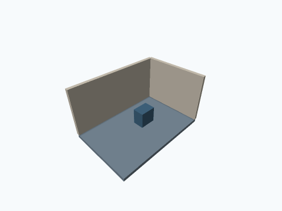
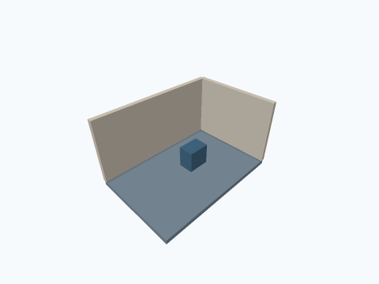

# 3D rendering quality — verification report

Date: 2026-11-10 (Asia/Kuala_Lumpur). Branch: `improve/3d-render-quality`.

## Implementation

Graphics quality Low/Medium/High, Anti-aliasing, Soft/Normal/Strong lighting, Texture detail Low/Medium/High, Contact shadows, automatic quality reduction and a frame-rate readout are implemented and persisted. New projects default to Shaded with Edges. Existing explicit project view modes stay intact.

The renderer prefers a 24/32-bit single-sample EGL window and uses GLES3 4×/2× MSAA colour plus 24-bit depth renderbuffers when supported and within the allocation budget. It explicitly resolves scene colour before FXAA presents it to the window. GLES2 retains a single-sample FXAA fallback. Final loupe readback sees the post-processed window. Adaptive near/far planes, floor depth priorities, camera-following key/ambient lighting, semantic matte colours, minification/grazing-angle grain fading, cached distant LOD and transient adaptive quality are documented in [ARCHITECTURE.md](ARCHITECTURE.md).

## Automated checks

All **820 tests pass**, with zero failures, errors or skips: model 56, geometry 151, editing 259, storage 35 and app 319. There are 26 new tests. The complete test run succeeds in 7m 36s. The geometry suite is rerun after the final IFC material-association correction. Independent readers pass for 28 IFC files (including EXPRESS rules and geometry) and 16 OBJ/STL/glTF/GLB files. The debug APK builds and `lintDebug` reports **zero app/storage issues**. A final focused run passes all 23 export/settings tests after unused-resource/KTX cleanup; that focused test/APK/lint run completes in 5m 43s. The APK is generated at `app/build/outputs/apk/debug/app-debug.apk`.

Commands (JDK 21, Android SDK 35):

```sh
./gradlew --no-daemon --no-parallel -Pkotlin.compiler.execution.strategy=in-process --max-workers=2 \
  :core:model:test :core:geometry:test :core:editing:test \
  :core:data:testDebugUnitTest :app:testDebugUnitTest
./gradlew --no-daemon --no-parallel -Pkotlin.compiler.execution.strategy=in-process --max-workers=2 \
  :app:assembleDebug lintDebug
python3 scripts/gles_shader_smoke.py
python scripts/validate_model_exports.py
git diff --check
```

The independent model readers require IfcOpenShell, Trimesh and pygltflib (plus pytest for IfcOpenShell's EXPRESS-rule validation). They run separately in a workspace virtual environment, with no production dependency added.

| Area | Coverage |
| --- | --- |
| Settings | Graphics JSON defaults/round trips, old quality enum compatibility, new-project view default, real Room close/reopen, legacy preference migration, Compose control selection/save/state restoration. |
| Clipping | Tight bounds outside a scene, camera inside a room, near surfaces in Roam/Walk, finite millimetre-scale matrices, billion-metre datum invariance, GPU matrix/project agreement and selected-preview bounds. |
| Materials/lighting | Measured palette contrast, shared wire/surface colour precedence, rotating camera light, ambient/diffuse ranges, actual rendered images with lighting/contact toggles. |
| AA/depth | EGL depth preference/fallback, sample-count/device/memory limits, production GLES shader compilation/rendering, actual 4× MSAA with 24-bit depth, explicit resolve, FXAA diagonal coverage and legal single-sample readback. |
| Detail/performance | Projected-size thresholds, exact wire-edge subsets, exclusion of walls/ceilings from equipment LOD, far texture fading, seamless grain phase, synthetic sustained slow/fast frame windows, hysteresis, manual preference limits and idle readout expiry. |
| Views/export | Close Roam/Walk/look views; antialiased image output and high-detail close views; door thresholds remain free of contact strips; hidden/X-ray/wireframe wall/floor rules; base colours/matte finish in glTF/GLB, IFC and OBJ vertex RGB. |
| Compatibility | Existing geometry, openings, routing, snapping, selection, history, storage, software bitmap/PDF and UI suites. Tests expecting the old default capture mode or exact unsmoothed edge pixels were updated to retain their original behavioral assertions. |

The MSAA smoke test deliberately uses a single-sample window with offscreen MSAA, matching production. Reading an unresolved multisampled default buffer is invalid and was not accepted as evidence of AA quality. The offscreen path also allows quality changes without recreating the EGL surface or scene VBOs. Optional target allocation failures retain the single-sample fallback.

The independent IFC reader additionally enforces material-association restrictions: spaces and opening voids use surface styles without invalid material relationships. STL remains colourless by format; OBJ colour requires support for its vertex-RGB extension.

## Review images

These images are generated by the actual native-bitmap `ViewExport` test path using the shared material/light/contact policies, rather than Android device screenshots. `GraphicsExportTest` also compares AA, texture detail and close-range views.

| Normal lighting | Soft lighting |
| --- | --- |
|  |  |

## Physical device QA

No Android emulator or physical phone/tablet is attached. Mesa validates native GL calls and shader behavior; Robolectric validates settings/UI/storage and native bitmap output. These checks do not establish tablet FPS, GPU driver/lifecycle reliability or thermal behavior.

On a tablet with a large project, exercise orbit, Walk/Roam and close-range look-around in both themes; compare AA Off/On and Low/Medium/High; inspect wall/floor contacts and thin diagonal wires; change lighting/detail; toggle automatic quality and the FPS readout; verify the actual sample/depth readout, idle behavior, loupe content, resize/orientation and background/resume. Verify model picking and dimensions remain precise while distant equipment changes LOD. No measured hardware frame-rate claim is made.
